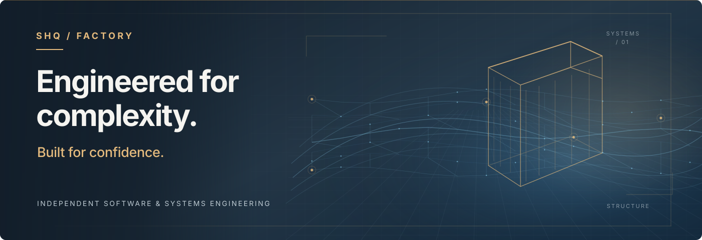
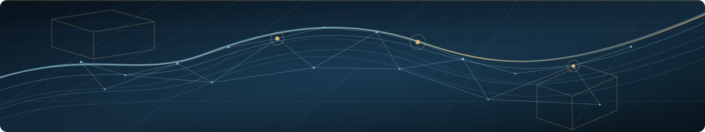

  <picture>
    <source media="(prefers-color-scheme: dark)" srcset="../assets/hero-dark.svg">
    
  </picture>

  <strong>INDEPENDENT SOFTWARE &amp; SYSTEMS ENGINEERING</strong>

  Architecture with intent. Engineering with evidence. Systems built to evolve.

---

## Engineering, as a discipline.

**SHQ Factory** is an independent software and systems engineering practice focused on purposeful digital products, dependable foundations, and the thoughtful management of complexity.

Our approach begins with a simple conviction: reliable software is not created by adding more features. It emerges from clear responsibilities, carefully defined boundaries, explicit trade-offs, and verification proportionate to the risks involved.

We value work that remains understandable, maintainable, and useful beyond its first implementation.

## Where we focus

| Systems & architecture | Purpose-built software | Research & engineering tools |
| :--- | :--- | :--- |
| Clear interfaces, resilient foundations, and deliberate system boundaries. | Practical applications and tools designed around real professional workflows. | Protocols, reusable components, and evidence-informed technical investigation. |

## Principles that guide our work

**01 / Architectural integrity**  
Define responsibilities, state, and interfaces before allowing complexity to spread.

**02 / Security by design**  
Treat trust boundaries, data stewardship, and failure behavior as engineering concerns from the outset.

**03 / Evidence over assertion**  
Distinguish an intended property from an implemented mechanism—and both from demonstrated verification.

**04 / Deliberate interoperability**  
Prefer explicit contracts, modular systems, and replaceable integration boundaries over unnecessary lock-in.

**05 / Responsible evolution**  
Make room for correction, new evidence, and changing requirements without losing architectural coherence.

  

## A considered approach to complexity

The tools may change. The engineering questions remain:

*What should this system guarantee? Where does authority belong? How will failure be handled? What evidence supports our confidence?*

These questions shape how we design, build, and improve.

---

  <strong>Build deliberately. Verify rigorously. Evolve responsibly.</strong>

